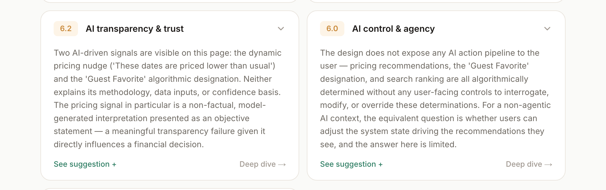
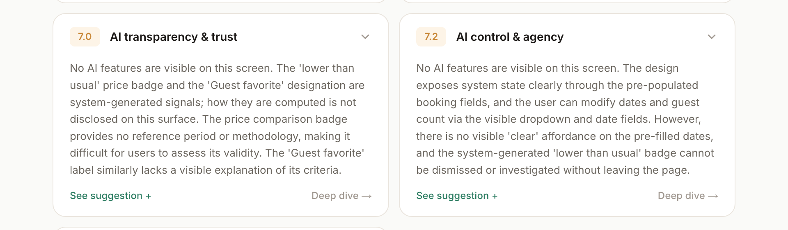
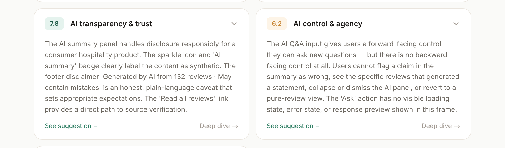

# One real wrong answer: Candor called ordinary UI "AI"

Evidence pack for portfolio Section 3. Every result here was produced by the
real `/api/audit` route (`claude-sonnet-4-6`) on November 5, 2026. The Markdown
in `exports/` was produced by the app's own Markdown export code, and the
screenshots are of the app's own results page.

## The design audited

`screenshots/input-airbnb.png`: an Airbnb listing page (Carolina, Puerto Rico
condo), run in **Deep critique** mode with no context or stated intent.

## What Candor said that was wrong

Deep mode scores two AI dimensions: *AI transparency & trust* and *AI control
& agency*. The screen has no visible AI feature. Nothing on it is labelled AI,
there's no sparkle icon or chat box, and no copy says a model produced anything.
Candor decided there was AI anyway and stated it as fact:

> "Two AI-driven signals are visible on this page: the dynamic pricing nudge
> ('These dates are priced lower than usual') and the 'Guest Favorite'
> algorithmic designation … The pricing signal in particular is a non-factual,
> model-generated interpretation presented as an objective statement."
> (`exports/before-v0-original-prompt.md`)

How "lower than usual" is computed isn't visible on the page. Candor invented a
mechanism, graded the page down for not disclosing it (AI trust **6.2**, AI
control **6.0**), and made it a headline of the Designer's Read: *"The areas
that genuinely need attention are the AI transparency around dynamic pricing
signals…"* So the tool broke the same rule it was enforcing, `[Fact vs.
non-fact]`: it presented an inference about the system as an observed fact.

It wasn't a one-off. All 3 runs on the original prompt did it, with 6 to 10
"AI / model / algorithmic" claims per run (see the run log).

## Why it happened

Deep mode *always* scores the AI dimensions. For non-AI screens the prompt
only said one thing: "If the design is not AI-powered, assess how well its
structure supports users who are working alongside AI tools". It never asked
the model to *establish* whether AI was present, never said what counts as
evidence, and gave it no way to answer "none". With an AI rubric to fill in,
the model found AI to fill it with.

## What I changed (`prompt-change.diff`)

| Layer | Change |
|---|---|
| **Guardrail** (system prompt) | A grounding rule for all modes: critique what's visible, describe icons literally, and label any guess about how something is computed as inference. Never score a design down for a mechanism you can't see. |
| **Guidance** (deep addendum) | An *AI surface check* before dimensions 9–10. Only on-screen cues count: labels like "AI" or "generated", sparkle icons, chat inputs, attribution copy. Prices, badges, ratings and rankings are explicitly *not* evidence. If no AI is found, the dimensions are scored on system transparency and control instead. |
| **Schema** | A new required field, placed before `dimensions` so the model commits to it before scoring: `aiSurface: { detected: boolean, evidence: string[] }`, where `evidence` must quote the visible elements. |
| **Interface** | The results page and Markdown export show the verdict above the cards: *"No AI features visible · AI dimensions scored on system transparency and control"*, or *"AI features detected: …"* with the quoted evidence. A reader can check the claim against the screenshot. |

### Iteration 2: the first fix was only partly followed

v1 stopped the false claims, but in 3 of 3 runs the model still tagged its
points with the AI heuristic labels (`[Fact vs. non-fact]` …), and one run
still said "algorithmically derived". The cause was a conflicting instruction
in the *user* prompt, "Begin each point with the heuristic name in square
brackets", which is closer to the output and more specific than the
system-prompt rule, so it won. v2 put an explicit `IF aiSurface.detected IS
FALSE / TRUE` branch inside that same note. After that, compliance was 4 of 4.

## What it said after

> "No AI features are visible on this screen. The 'lower than usual' price
> badge and the 'Guest favorite' designation are system-generated signals; how
> they are computed is not disclosed on this surface. The price comparison
> badge provides no reference period or methodology, making it difficult for
> users to assess its validity." (`exports/after-v2-fixed-prompt.md`)

The useful critique survived: the badge still doesn't say what it's compared
against. The invented mechanism is gone. Scores moved to 7.0 / 7.2, and the
Designer's Read now leads with the real issues (booking-card price breakdown,
the odd search field).

## Control: did the fix just switch AI critique off?

To check, I built `screenshots/input-control.png` (source:
`raw/control-screen.html`): the same kind of listing page with one change, a
clearly labelled "✦ AI summary" of reviews, a "Generated by AI · May contain
mistakes" line, and an "Ask about this home" box. With the v2 prompt, Candor
detected it 3 of 3 times. It quoted exactly those three elements as evidence
and gave the full heuristic critique, including a sharp catch: the summary
blends guest opinion with factual-sounding claims ("elevator can be slow")
without telling them apart.

## Run log (deep critique, all runs)

| Prompt | Screen | aiSurface.detected | AI trust | AI control | "AI / model / algorithmic" claims | Bracket tags on non-AI screen | AI in Designer's Read |
|---|---|---|---|---|---|---|---|
| v0 original | Airbnb | — | 6.2 | 6.0 | 10 | 7 | yes |
| v0 original | Airbnb | — | 6.5 | 6.0 | 6 | 9 | no |
| v0 original | Airbnb | — | 7.0 | 7.2 | 10 | 7 | no |
| v1 surface check | Airbnb | false | 7.0 | 7.2 | 0 | 6 | no |
| v1 surface check | Airbnb | false | 7.0 | 7.0 | 2 | 7 | no |
| v1 surface check | Airbnb | false | 7.0 | 7.2 | 0 | 6 | no |
| v2 conditional | Airbnb | false | 7.0 | 7.2 | 0 | 0 | no |
| v2 conditional | Airbnb | false | 7.0 | 7.2 | 0 | 0 | no |
| v2 conditional | Airbnb | false | 7.0 | 7.2 | 0 | 0 | no |
| v2 conditional | Airbnb | false | 7.0 | 7.2 | 0 | 0 | no |
| v2 conditional | AI control | **true** | 7.3 | 6.1 | n/a (real AI) | 9 (expected) | yes |
| v2 conditional | AI control | **true** | 7.9 | 6.8 | n/a (real AI) | 8 (expected) | yes |
| v2 conditional | AI control | **true** | 7.8 | 6.2 | n/a (real AI) | 8 (expected) | yes |

Score alone doesn't catch the defect. The third v0 run scored 7.0 / 7.2, the
same as the fixed prompt, while still making 10 false claims about how the
page works. You have to read the text to grade it.

## What the prompt didn't fix (worth saying)

The price badge's icon is a **green price tag**. Candor calls it a **"green
leaf"** in most runs, before *and* after the fix, and builds on the misread:
*"subconsciously signals value and eco-consciousness"*. In one run it even
recommends replacing the leaf with *"a price-tag … icon"*. The grounding rule
("if you cannot identify an icon with confidence, say so") doesn't help,
because the model isn't unsure. It's confidently wrong. This is a perception
limit, not an instruction problem. Fixing it means changing other layers:
higher-resolution input or crops for small UI elements, a stronger vision
model, or an interface that lets the designer mark a finding as wrong and
rerun with that correction as context.
